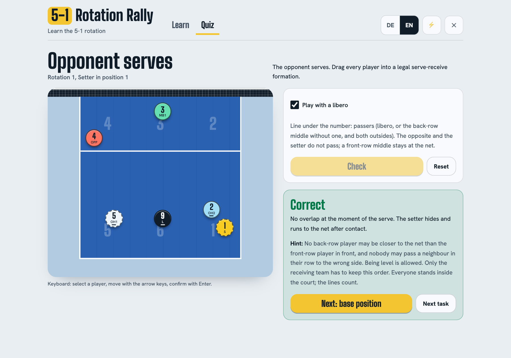
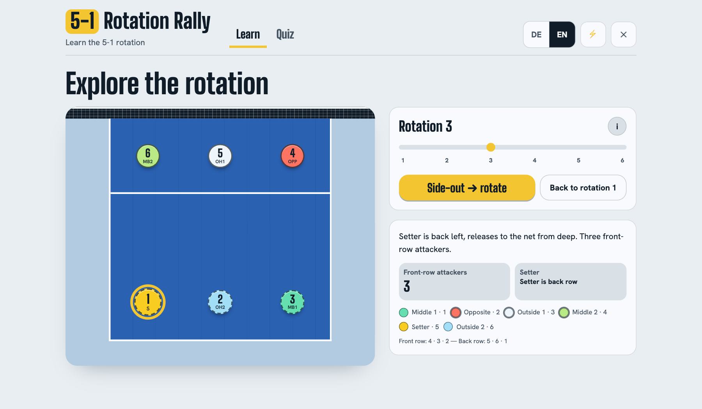
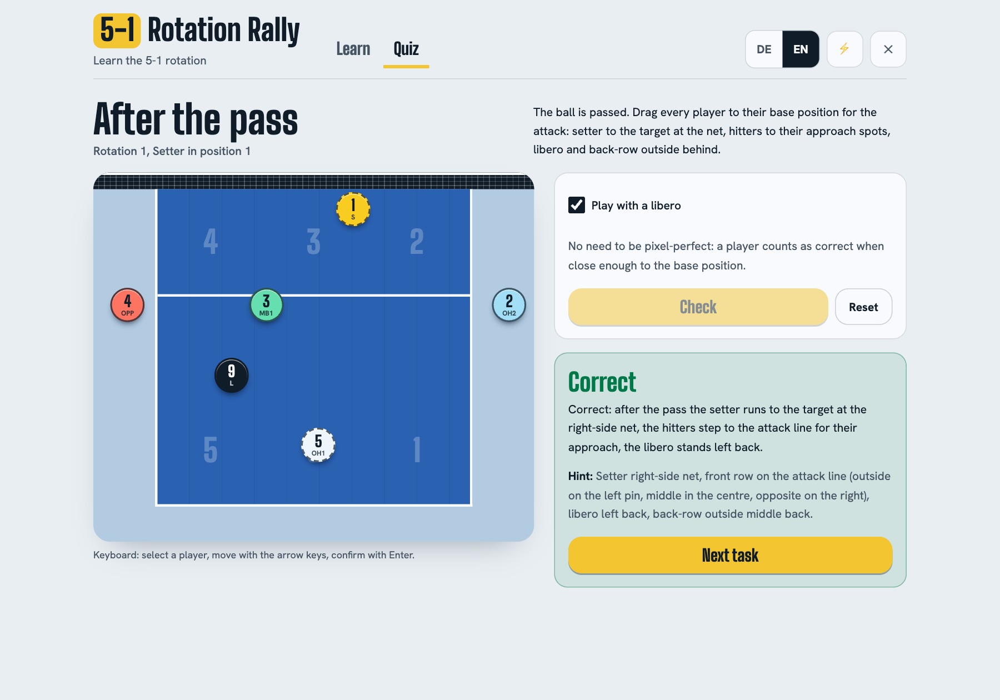

# 5-1 Rotation Rally

[](https://github.com/Simons-Github/volley-rotations/actions/workflows/ci.yml) [](LICENSE)

An interactive trainer for the volleyball 5-1 system. You step through the six rotations, then drag players into legal serve-receive positions and get feedback on overlaps.

**Live demo:** [volley.berger-labs.com](https://volley.berger-labs.com). No account needed.



## Features

- Learn mode: walk through rotations 1 to 6 or trigger a side-out, with a short note per rotation
- Serve-receive quiz with a random rotation per task
- Drag players with the mouse or touch, or move them with the arrow keys
- "Check" highlights overlapping pairs and players outside the court, and shows a legal example
- After a correct receive formation, move every player to their attack position
- German and English, with or without a libero

<p>
  
  
</p>

## Tech stack

| | |
| --- | --- |
| Framework | TanStack Start and Router, React, TypeScript (strict) |
| UI | Tailwind CSS 4, dnd-kit for dragging, Framer Motion |
| i18n | i18next |
| Tooling | Bun, Vite, Vitest, GitHub Actions, Vercel |

There is no backend. Settings and the last 500 quiz results are stored in `localStorage`.

## How it works

All volleyball rules live in `src/domain/rotation.ts` as plain functions without any UI code: line-ups, rotating and the overlap check. Because of that, the unit tests can check every rotation without rendering a component.

The positions for all six rotations are data in `src/domain/formations.json`, not code. If a position is wrong, I fix one number. Coordinates are normalised: x goes from 0 to 1 across the court, y from 0 at the net to 1 at the end line. The court can scale to any size, and values outside that range put a player next to the court.

For attack positions there is a tolerance of 0.14 court units around the model spot, because real teams don't stand on exact points.

## Running locally

You need Bun and Node.js 20.19+ or 22.12+. There are no environment variables.

```sh
bun install
bun run dev
bun run test
```

More details are in [docs/development.md](docs/development.md).

## Tests

`src/domain/rotation.test.ts` covers line-ups, rotation order, overlaps, the libero and the attack positions. CI runs the type check, lint, tests and build on every push.

## Limitations

- Only the 5-1 system. No 4-2 or 6-2, no opponent side and no defence.
- No task for your own serve: under the rule below the serving team has no rotational order to practise.
- The overlap check follows rule 7.4 of the [FIVB Official Volleyball Rules 2025-2028](https://www.fivb.com/volleyball/the-game/official-volleyball-rules/): only the receiving team has to be in rotational order, being level with a neighbour is allowed, and players must stand inside the court. Some leagues use other rules, so check yours.
- Each player is a single point, so the app does not judge positions by feet.
- The formations follow the 5-1 diagram on learnvolley.com. Your team's system may be different.
- Fonts are loaded from Google Fonts.

## License

MIT
